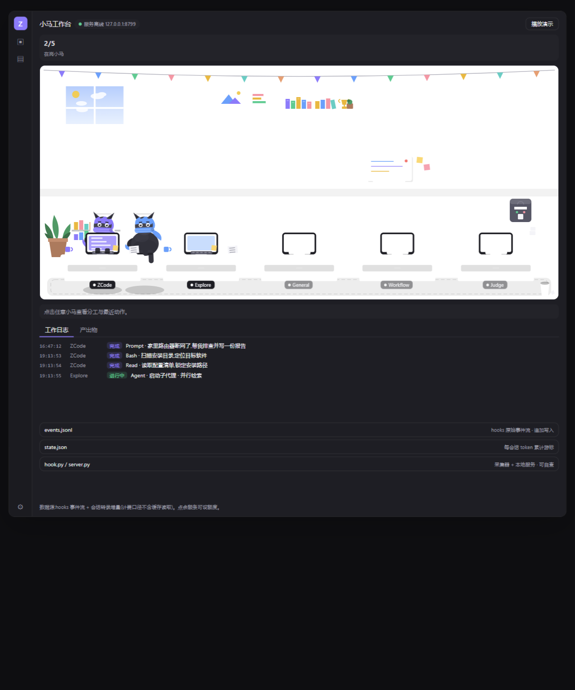

# ZCode 小马工作台 · Pony Workbench

给 [ZCode](https://zcode.ai) 桌面客户端做的一套 **Marvis 式实时工作台**:把 AI Agent 编排过程中"谁在干活、干到什么程度"画成一间像素办公室——每匹戴围巾的小马就是一个 agent,任务一来就坐下疯狂敲键盘,没活的马会喝茶、玩手柄(屏幕变成弹珠小游戏)、下桌溜达。



灵感来自腾讯 Marvis 桌面助手的侧边栏:用"可感知的拟物隐喻"呈现不可见的 agent 编排——动画由真实事件流驱动,而不是装饰。

## 功能

- **虚拟办公室动画**(Canvas 手绘):五个工位对应 ZCode 的 agent 编制(主编排 ZCode、Explore、General、Workflow、Judge),小马有鬃毛、尾巴、腮红、条纹围巾,眨眼/前倾/冒汗等微表情;
- **行为状态机**:`IDLE → WORKING → HIGH_PRESSURE → ☕`;干活时键帽乱飞、代码行滚动;空闲自动轮换喝茶/玩游戏/溜达;
- **实时工作日志**:hooks 事件流驱动,逐条滚动每个 agent 的工具调用(完成/失败/进行中);
- **两个视图**:
  - 浏览器完整版 `http://127.0.0.1:8799/`(1280×900 全幅);
  - 系统悬浮侧边栏(Marvis 式):无边框、置顶、停靠屏幕右缘,可折叠成小把手,被最小化/挪走会自动归位。

## 数据流

```
ZCode hooks (UserPromptSubmit / Pre-PostToolUse / Stop / SessionStart)
   │  stdin JSON
   ▼
hook.py ──追加──▶ events.jsonl ◀──尾读── server.py (127.0.0.1:8799)
                                  │                └─ Win32 keeper:停靠/置顶/折叠/自愈
                                  ▼
                 workbench.html / widget.html 轮询渲染
```

- `hook.py`:事件采集器,注册为 ZCode 的 `process` 型 hooks,追加写入 JSONL,任何异常静默吞掉、永不阻塞会话;
- `server.py`:本地服务(事件尾读接口 + 静态页面)+ 窗口管理线程(`SetWindowPos` 停靠置顶、检测最小化自动恢复、页面心跳断流自动重启侧边栏);
- `widget.py`:启动器,拉起服务并用 Edge `--app` 模式开无边框窗口(带反后台节流参数)。

## 安装(Windows)

```bash
pip install psutil pywebview   # pywebview 可选,当前方案用 Edge --app,不需要

# 1) 注册 hooks 到 ~/.zcode/cli/config.json(会备份原配置)
python register_hooks.py

# 2) 启动侧边栏(自动拉起服务;浏览器打开 http://127.0.0.1:8799/ 看完整版)
python widget.py
# 或双击 start-workbench.cmd

# 3) (可选)开机自启:把 widget.py 加入 HKCU\...\Run
```

> hooks 配置在**会话启动时**读取——注册后从下一个 ZCode 会话开始,真实工具调用才会流入办公室。在此之前页面会播放内置演示。

**卸载**:删除 `~/.zcode/cli/config.json` 里的 `hooks` 字段(或用注册时的备份恢复),结束 `pythonw` 进程,删除 `HKCU\Software\Microsoft\Windows\CurrentVersion\Run` 下的自启项。

## 目录

| 文件 | 作用 |
|---|---|
| `hook.py` | hooks 事件采集器 → events.jsonl |
| `server.py` | 本地服务 + 窗口停靠 keeper + 冻结自愈 |
| `widget.py` | 侧边栏启动器(Edge --app + 反节流参数) |
| `widget.html` | 侧边栏紧凑版 UI |
| `workbench.html` | 浏览器完整版 UI |
| `register_hooks.py` | 注册/更新 ZCode hooks 配置 |
| `smoke_test.py` | hook.py 冒烟测试(喂样例载荷) |
| `burst_demo.py` | 通过真实 hook.py 注入一串演示事件 |

运行时产物(`events.jsonl`、`edge-profile/` 等)已在 `.gitignore` 中排除。

## 已知简化

- 子代理内部工具调用在 hooks 载荷里无法与主代理区分,v1 记在主编排名下;
- agent 工位按类型映射,未知子代理类型会自动认领空工位并换围巾色。

## License

[MIT](LICENSE)
